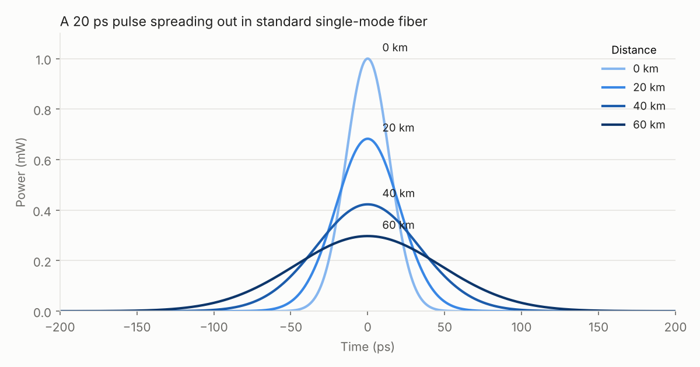

# Optical fiber simulator

`cleanrl_utils.fiber` simulates an optical pulse travelling through single-mode fiber, and wraps
it in a Gymnasium environment that CleanRL's continuous-action agents can train on.

## Physics

The simulator solves the nonlinear Schrödinger equation for the pulse envelope `A(z, T)` with the
symmetric split-step Fourier method:

```
dA/dz = -(alpha/2) A - i (beta2/2) d²A/dT² + (beta3/6) d³A/dT³ + i gamma |A|² A
```

| Effect | Parameter | Default (SMF-28 at 1550 nm) |
|---|---|---|
| Attenuation | `alpha_db` | 0.2 dB/km |
| Chromatic dispersion | `beta2` | -21.7 ps²/km |
| Third-order dispersion | `beta3` | 0 ps³/km |
| Kerr nonlinearity (self-phase modulation) | `gamma` | 1.3 1/(W km) |

Units are ps, km and W throughout.

```python
from cleanrl_utils.fiber import Fiber, gaussian_pulse, propagate, rms_width, time_grid

t = time_grid(n_points=2048, window=1000.0)   # ps
pulse = gaussian_pulse(t, t0=20.0, peak_power=1e-3)
fiber = Fiber(length=60.0)

out = propagate(pulse, t, fiber)                                 # output field
z, fields = propagate(pulse, t, fiber, n_snapshots=3)            # field along the fiber
print(rms_width(out, t) / rms_width(pulse, t))                   # ~3.4x broader
```



Other helpers: `sech_pulse` and `soliton_peak_power` (solitons), `apply_dispersion` (lumped
dispersion compensation), and the metrics `energy`, `peak_power`, `spectrum` and
`intensity_fidelity`.

## `FiberDispersionComp-v0` environment

A pulse crosses a link of 4 fiber spans whose lengths (40 to 80 km) are drawn at random each
episode. For every span the agent chooses:

* **launch power** (`action[0]`, -10 to 20 dBm): too low and amplifier noise dominates, too high and
  self-phase modulation distorts the pulse;
* **dispersion compensation** (`action[1]`, up to 100 km worth of fiber dispersion) applied after the span.

The observation is the received intensity profile (64 bins), its RMS width relative to the
transmitted pulse, and progress along the link. The reward after each span is the fidelity
(0 to 1) between the received and transmitted intensity profiles, so the best possible episode
return is just under 4.

```bash
uv run python cleanrl/ppo_continuous_action.py \
    --env-id cleanrl_utils.fiber:FiberDispersionComp-v0 \
    --total-timesteps 100000 --num-envs 4
```

As a reference, a random policy scores about 2.1, the ideal policy (exact compensation at
about 5 to 10 dBm) about 3.95, and PPO with the command above reaches about 3.2 in 100k steps.

## Tests

```bash
uv run pytest tests/test_fiber.py
```

The tests check the simulator against analytic results: attenuation matches the dB loss,
Gaussian pulse broadening matches `sqrt(1 + (z / L_D)^2)`, a fundamental soliton keeps its shape,
and exact compensation recovers the input pulse.
